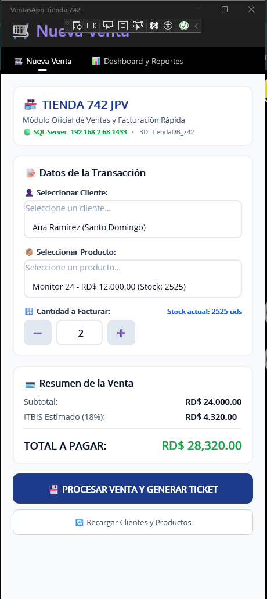
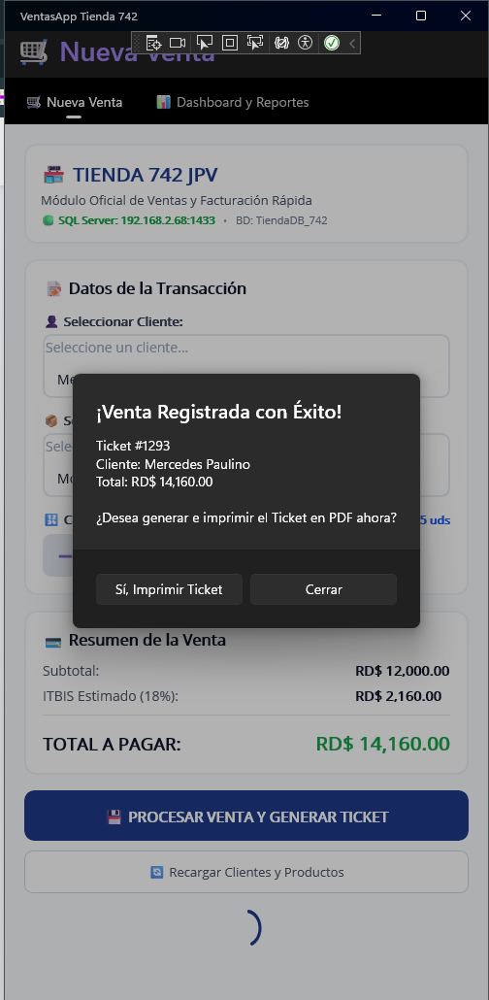
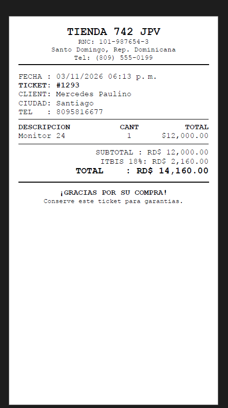
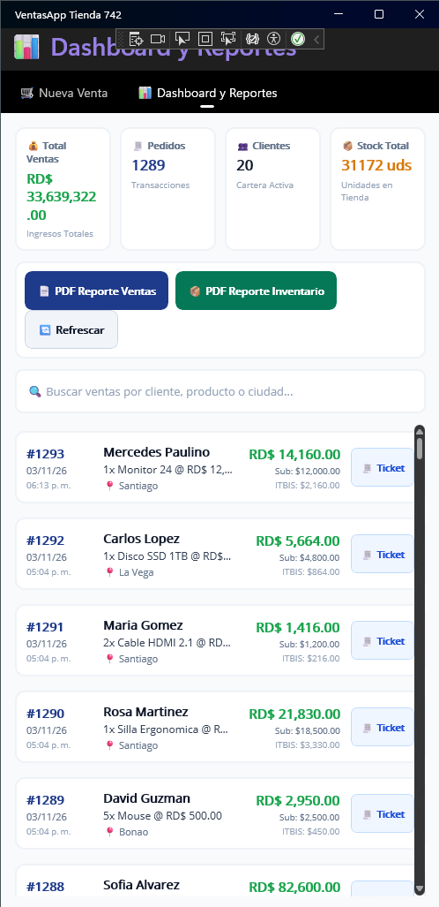
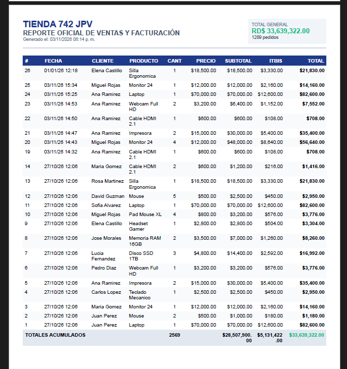
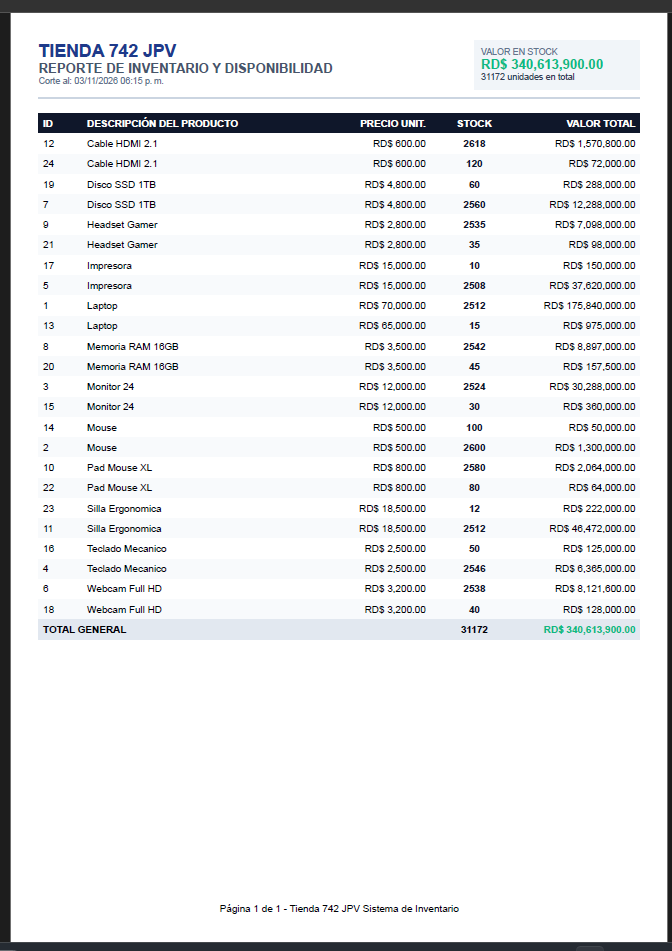
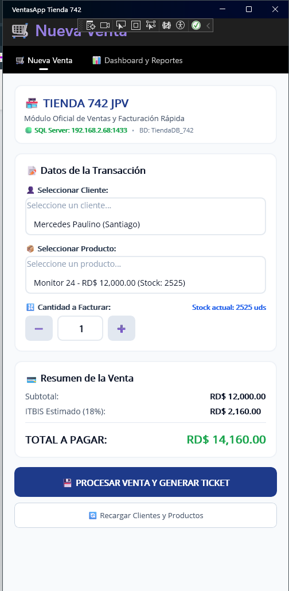

# 🏪 VentasApp_Tienda742 - Sistema de Ventas, Facturación y Reportes en .NET MAUI

[](https://juancitopena.github.io/VentasApp_Tienda742/)
[](https://dotnet.microsoft.com/)
[](https://www.microsoft.com/es/sql-server/)

> 🌐 **TUTORIAL MAESTRO INTERACTIVO EN VIVO (GITHUB PAGES):**  
> Accede a la masterclass completa paso a paso con visores de código, narrador por voz y descargas de scripts SQL:  
> 👉 **[https://juancitopena.github.io/VentasApp_Tienda742/](https://juancitopena.github.io/VentasApp_Tienda742/)**

Aplicación empresarial desarrollada en **.NET 9 MAUI (C# y XAML)** conectada a **Microsoft SQL Server (192.168.2.68:1433)**, con transaccionalidad ACID en el **Módulo de Ventas**, **Mini Dashboard Ejecutivo**, **Historial de Pedidos** y **Generación e Impresión de Documentos en PDF** (Ticket Térmico POS 80mm, Reporte de Ventas A4 e Inventario A4).

---

## 📸 Portadas y Capturas Oficiales del Proyecto en Producción

### 🛒 1. Módulo POS de Ventas y Emisión de Tickets
| 🛒 POS - Nueva Venta | 🧾 Confirmación y Disparo | 🎫 Ticket Térmico 80mm |
| :---: | :---: | :---: |
|  |  |  |
| **Punto de Venta Reactivo**<br>Selección de cliente, producto y cálculo de ITBIS (18%) | **Transacción ACID Exitosa**<br>Confirmación y disparo de impresión | **Comprobante Térmico POS**<br>Formato 80mm generado con QuestPDF |

### 📊 2. Dashboard Ejecutivo y Reportería Vectorial PDF (QuestPDF)
| 📊 Mini-Dashboard en Vivo | 📄 Reporte Oficial de Ventas A4 | 📦 Reporte de Inventario A4 |
| :---: | :---: | :---: |
|  |  |  |
| **KPIs Bento en Tiempo Real**<br>Ventas, Pedidos, Clientes, Stock y Buscador | **Facturación Consolidada**<br>Documento formal con ITBIS y totales | **Inventario Valorado**<br>Disponibilidad y valor total en bodega |

### 📱 3. Facturación en Ruta / Móvil
| 📱 Selección de Clientes y Validación de Stock |
| :---: |
|  |
| **Flujo de Venta Móvil en Tiempo Real**<br>Descuento atómico de existencias en SQL Server |

---

> 📖 **MANUAL MAESTRO DE INGENIERÍA PASO A PASO (100% COMPLETO):**  
> Para consultar la guía didáctica exhaustiva con todas las explicaciones teóricas, configuración de red, firewall, script SQL completo y código fuente íntegro archivo por archivo, abre el documento:  
> 👉 [`MANUAL_COMPLETO_PASO_A_PASO.md`](./MANUAL_COMPLETO_PASO_A_PASO.md)

---

## 📌 1. Parámetros de Conexión a Base de Datos
- **Servidor SQL:** `192.168.2.68`
- **Puerto:** `1433` (`192.168.2.68,1433`)
- **Base de Datos:** `TiendaDB_742`
- **Usuario:** `JUANCITO`
- **Contraseña:** `123456`
- **Archivo de Configuración:** [`VentasApp_Tienda742/Services/ConfigDB.cs`](./VentasApp_Tienda742/Services/ConfigDB.cs)

---

## 🛠️ 2. Módulos Principales de la Aplicación

### 🛒 Pestaña 1: Nueva Venta (`VentasApp_Tienda742/Views/NuevaVentaPage.xaml`)
- **Catálogos Reactivos:** Carga automática de clientes y productos con existencias desde SQL Server.
- **Control de Cantidad y Validación:** Control `+`/`-` con bloqueo automático si se intenta vender más unidades que el stock disponible.
- **Cálculo Financiero en Vivo:** Desglose instantáneo de Subtotal, ITBIS (18%) y Total general a pagar.
- **Transacción Atómica (ACID):** Descuenta el stock y registra el pedido de forma simultánea.
- **Emisión Directa de Ticket:** Apertura automática del comprobante térmico en PDF de 80mm tras procesar la venta.

### 📊 Pestaña 2: Dashboard y Reportes (`VentasApp_Tienda742/Views/DashboardReportesPage.xaml`)
- **Mini Dashboard Bento (4 KPIs en tiempo real):**
  1. 💰 **Total Ventas:** Monto acumulado en RD$.
  2. 🧾 **Pedidos:** Cantidad de compras facturadas.
  3. 👥 **Clientes:** Cartera de clientes registrados.
  4. 📦 **Stock Total:** Unidades disponibles en almacén.
- **Búsqueda en Vivo:** Filtrado instantáneo por cliente, producto o ciudad.
- **Reportes Vectoriales PDF (QuestPDF):**
  - `📄 Reporte de Ventas A4:` Cuadro analítico de facturación con desglose de impuestos y totales.
  - `📦 Reporte de Inventario A4:` Catálogo valorado con alertas visuales para productos con bajo stock.
  - `🧾 Reimpresión de Tickets:` Botón individual para reimprimir cualquier ticket del historial.

---

## 📂 3. Estructura Limpia del Repositorio y Solución

Para garantizar que cualquier desarrollador pueda clonar o descargar el repositorio sin errores de dependencias o rutas relativas, el código fuente reside encapsulado en su propia carpeta `VentasApp_Tienda742/`, mientras que la solución `.sln`, documentación y scripts se ubican en la raíz:

```text
VentasApp_Tienda742/
├── VentasApp_Tienda742.sln         # Solución principal (doble clic para abrir en Visual Studio)
├── README.md                       # Documentación ejecutiva del proyecto
├── MANUAL_COMPLETO_PASO_A_PASO.md  # Manual didáctico exhaustivo paso a paso
├── TUTORIAL_MAESTRO_BRUTALISTA.html# Masterclass interactiva web
├── index.html                      # Portal interactivo para GitHub Pages
├── favicon.png / favicon.svg       # Favicons del portal web
├── Screenshot_84.png ... 90.png    # Capturas de pantalla oficiales en producción
├── *.sql                           # Scripts de esquema, datos y guía didáctica SQL Server
└── VentasApp_Tienda742/            # 🚀 Carpeta del Proyecto .NET 9 MAUI
    ├── VentasApp_Tienda742.csproj  # Definición del proyecto, paquetes NuGet y TargetFrameworks
    ├── App.xaml / App.xaml.cs      # Arranque de la app e inicialización QuestPDF
    ├── AppShell.xaml               # Menú y barra de navegación por pestañas
    ├── MauiProgram.cs              # Builder de MAUI, fuentes y DI
    ├── Models/                     # Entidades: Cliente, Producto, Venta, DashboardStats
    ├── Views/                      # Formularios XAML y Code-Behind reactivo
    ├── Services/                   # Conexión ADO.NET (ConfigDB, VentaService, PdfService)
    ├── Platforms/                  # Configuraciones nativas (Windows, Android, iOS, Mac)
    └── Resources/                  # Recursos gráficos, fuentes y estilos
```

---

## 🚀 4. Instrucciones de Compilación y Ejecución

### Opción A: Desde Visual Studio 2022 (Recomendado)
1. Abrir el archivo de solución `VentasApp_Tienda742.sln` directamente en Visual Studio 2022.
2. Seleccionar como destino de compilación **Windows Machine** (o emulador Android).
3. Presionar **F5** (o `Ctrl + F5` para ejecutar sin depurador).

### Opción B: Desde PowerShell / Terminal CLI
```powershell
# 1. Clonar o navegar a la carpeta del repositorio
cd VentasApp_Tienda742

# 2. Restaurar y compilar la solución completa
dotnet build VentasApp_Tienda742.sln -f net9.0-windows10.0.19041.0

# 3. Ejecutar la aplicación
dotnet run --project VentasApp_Tienda742 -f net9.0-windows10.0.19041.0
```
